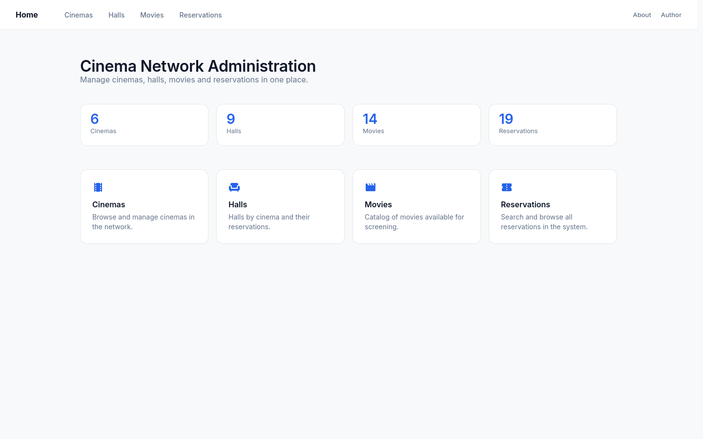
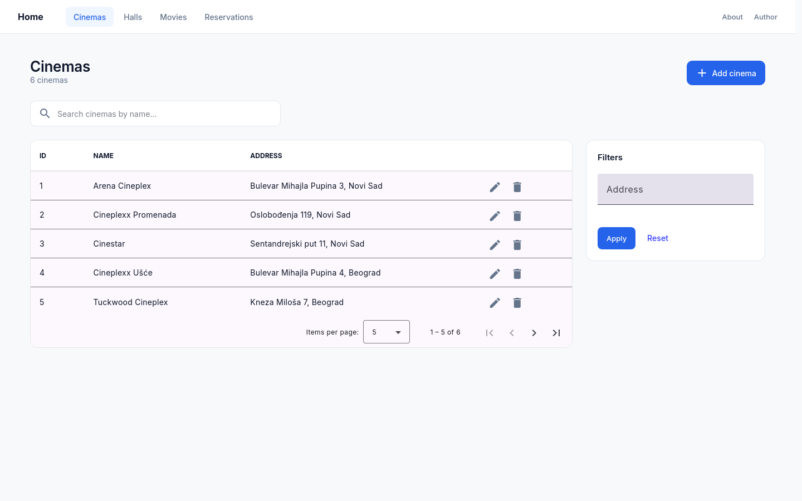
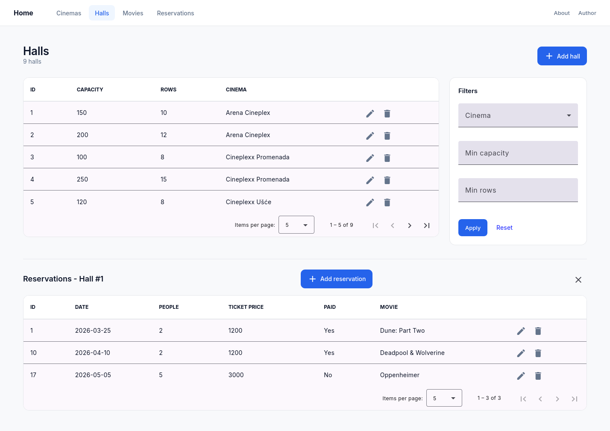
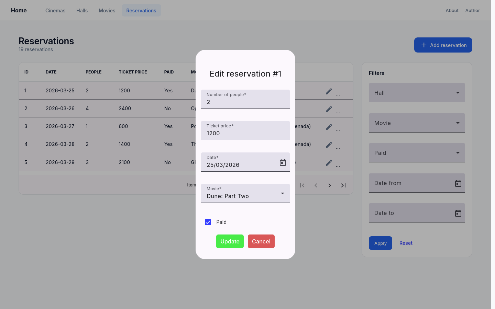
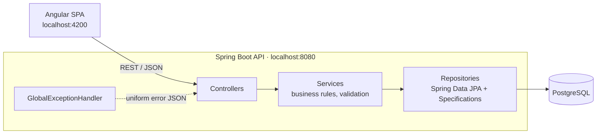
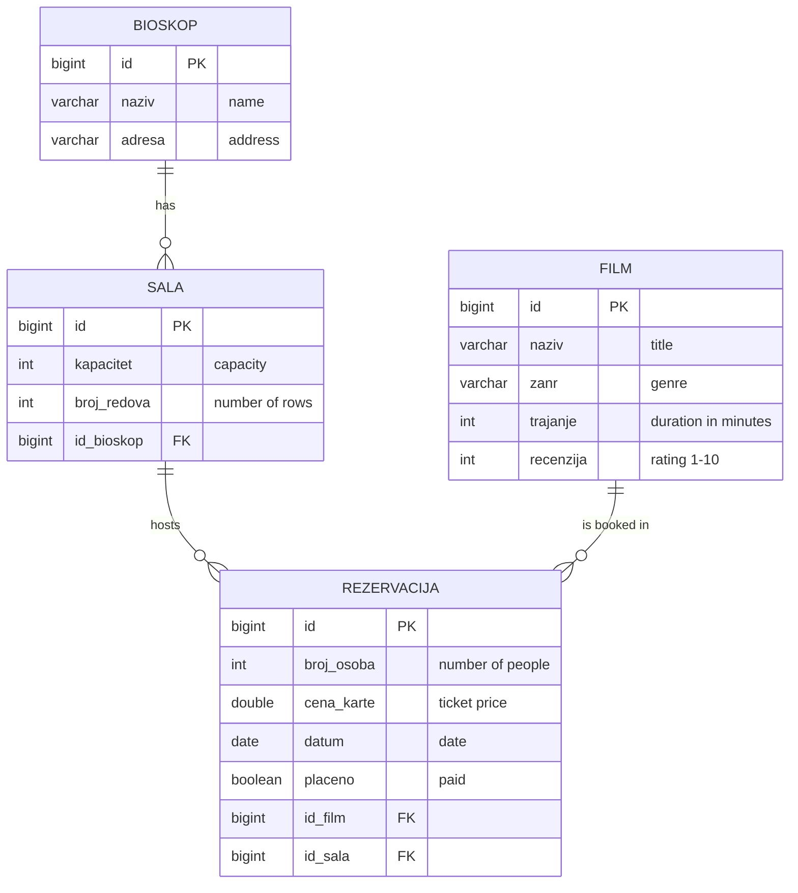

# Cinema Network Administration


A full-stack web application for managing a cinema network: cinemas, their halls, the movie catalog and ticket reservations. It is built as a multi-tier application with a **Spring Boot REST API**, a **PostgreSQL** database and an **Angular** single-page frontend.

> **Academic project.** Developed for the *Multi-tier Application Development* course at the Faculty of Technical Sciences, University of Novi Sad. The user interface is in English, while the domain model, API paths and code identifiers are in Serbian, as required by the course. See the [glossary](#glossary) below.

## Screenshots

| Home | Cinemas |
|---|---|
|  |  |

| Halls with nested reservations | Edit dialog |
|---|---|
|  |  |

## Features

- **Full CRUD** for four related entities: cinemas, halls, movies and reservations
- **Server-side pagination and sorting** on every table
- **Dynamic filtering** built with JPA Specifications (any combination of optional filters), plus debounced live search by name
- **Master-detail view**: selecting a hall opens its reservations below the table, and the same reservation component also works as a standalone page with its own filters
- **Validation on both sides**: Angular form validation in the UI, and Bean Validation with consistent error responses in the API
- **Centralized error handling**: one `@RestControllerAdvice` maps exceptions to a uniform JSON error format
- **Dashboard**: the home page shows live counts for every entity
- **Integration tests**: 47 tests covering all REST endpoints, including validation and error cases

## Tech stack

| Layer | Technologies |
|---|---|
| Frontend | Angular 21 (standalone components, signals), Angular Material, TypeScript, RxJS |
| Backend | Java 17, Spring Boot 4, Spring Web MVC, Spring Data JPA (Hibernate), Bean Validation |
| Database | PostgreSQL |
| Testing | JUnit 6, Spring Boot Test |
| Build | Maven (wrapper included), Angular CLI / npm |

## Architecture



The backend follows a layered design. Every service extends one generic `CrudService<T>` interface. Controllers stay thin and only delegate to services. Services check that referenced entities exist before saving and throw exceptions, which `GlobalExceptionHandler` turns into HTTP responses.

### Data model



### Glossary

| Serbian (code / API) | English (UI) |
|---|---|
| Bioskop | Cinema |
| Sala | Hall |
| Film | Movie |
| Rezervacija | Reservation |
| naziv / adresa | name (title for movies) / address |
| kapacitet / broj redova | capacity / number of rows |
| zanr / trajanje / recenzija | genre / duration / rating |
| broj osoba / cena karte / datum / placeno | number of people / ticket price / date / paid |
| pretraga | search |

## Getting started

### Prerequisites

- **Java 17+**
- **Node.js** 20.19+, 22.12+ or 24+ (with npm)
- **PostgreSQL** running locally (default port `5432`)

### 1. Database

Create a database, or use the default `postgres` database. The backend reads its connection settings from environment variables and falls back to local defaults:

| Variable | Default |
|---|---|
| `DB_URL` | `jdbc:postgresql://localhost:5432/postgres` |
| `DB_USERNAME` | `postgres` |
| `DB_PASSWORD` | `postgres` |

The variables are listed in [`.env.example`](.env.example). Copy it to `.env` for your IDE run configuration, or export the variables in your shell.

> ⚠️ **The schema is recreated on every start** (`spring.jpa.hibernate.ddl-auto=create`) and filled with sample data from [`data.sql`](BackendProject/src/main/resources/data.sql). Do not point the application at a database that holds data you want to keep.

### 2. Backend

```bash
cd BackendProject
sh mvnw spring-boot:run          # Linux / macOS
mvnw.cmd spring-boot:run         # Windows
```

To use credentials other than the defaults:

```bash
DB_PASSWORD=your_password sh mvnw spring-boot:run
```

The API runs at `http://localhost:8080`.

### 3. Frontend

```bash
cd FrontendProject
npm install
npm start
```

Open `http://localhost:4200`. The API base URL is set in [`src/environments/environment.ts`](FrontendProject/src/environments/environment.ts).

### Running the tests

The integration tests start the application on a random port and run against the PostgreSQL database configured above. Each test class gets a freshly seeded schema.

```bash
cd BackendProject
sh mvnw test
```

## API reference

All list endpoints are paginated and accept the standard Spring Data parameters:

| Parameter | Description | Default |
|---|---|---|
| `page` | Zero-based page index | `0` |
| `size` | Page size (max `100`) | `10` |
| `sort` | Field and direction, e.g. `sort=naziv,asc` | none |

List endpoints return a Spring Data `Page` object (`content`, `totalElements`, `totalPages`, `number`, `size`, …).

### Cinemas: `/bioskop`

| Method | Path | Description |
|---|---|---|
| `GET` | `/bioskop` | List all cinemas |
| `GET` | `/bioskop/{id}` | Get a cinema by ID |
| `GET` | `/bioskop/grad?grad=` | Cinemas whose address contains the given city (404 if none) |
| `GET` | `/bioskop/pretraga?naziv=&adresa=` | Search by name and/or address (case-insensitive, partial match) |
| `POST` | `/bioskop` | Create a cinema |
| `PUT` | `/bioskop/{id}` | Update a cinema |
| `DELETE` | `/bioskop/{id}` | Delete a cinema, **together with its halls and their reservations** |

### Halls: `/sala`

| Method | Path | Description |
|---|---|---|
| `GET` | `/sala` | List all halls |
| `GET` | `/sala/{id}` | Get a hall by ID |
| `GET` | `/sala/bioskop?bioskopId=` | Halls of a cinema (404 if the cinema does not exist or has no halls) |
| `GET` | `/sala/pretraga?kapacitet=&brojRedova=&bioskopId=` | Search by **minimum** capacity, **minimum** number of rows and/or cinema |
| `POST` | `/sala` | Create a hall (requires `bioskop.id`) |
| `PUT` | `/sala/{id}` | Update a hall |
| `DELETE` | `/sala/{id}` | Delete a hall, **together with its reservations** |

### Movies: `/film`

| Method | Path | Description |
|---|---|---|
| `GET` | `/film` | List all movies |
| `GET` | `/film/{id}` | Get a movie by ID |
| `GET` | `/film/zanrovi` | List of distinct genres (not paginated) |
| `GET` | `/film/pretraga?naziv=&zanr=&maxMinuta=` | Search by title (partial), exact genre and/or maximum duration |
| `POST` | `/film` | Create a movie |
| `PUT` | `/film/{id}` | Update a movie |
| `DELETE` | `/film/{id}` | Delete a movie, **together with its reservations** |

### Reservations: `/rezervacija`

| Method | Path | Description |
|---|---|---|
| `GET` | `/rezervacija` | List all reservations |
| `GET` | `/rezervacija/{id}` | Get a reservation by ID |
| `GET` | `/rezervacija/film?filmId=` | Reservations for a movie (404 if none) |
| `GET` | `/rezervacija/sala?salaId=` | Reservations in a hall (404 if none) |
| `GET` | `/rezervacija/pretraga?filmId=&salaId=&placeno=&datumOd=&datumDo=` | Search by movie, hall, paid status and/or date range (`yyyy-MM-dd`, inclusive) |
| `POST` | `/rezervacija` | Create a reservation (requires `film.id` and `sala.id`) |
| `PUT` | `/rezervacija/{id}` | Update a reservation |
| `DELETE` | `/rezervacija/{id}` | Delete a reservation |

All search parameters are optional and can be combined. A search with no matches returns an empty page with status `200`.

Example request body for `POST /rezervacija`:

```json
{
  "brojOsoba": 2,
  "cenaKarte": 1200,
  "datum": "2026-06-01",
  "placeno": true,
  "film": { "id": 1 },
  "sala": { "id": 1 }
}
```

### Error responses

Every error uses the same JSON structure:

```json
{
  "timestamp": "07-10-2026 14:30:00",
  "status": 400,
  "error": "Validation Failed",
  "message": "Podaci nisu ispravni",
  "path": "/bioskop",
  "details": ["naziv: Naziv bioskopa je obavezan i ne sme biti prazan."]
}
```

| Status | When |
|---|---|
| `400` | Validation failed, wrong parameter type, missing related entity ID, or a database constraint violation |
| `404` | The requested entity, or an entity it references, does not exist |
| `500` | Unexpected server error |

Error messages are in Serbian, like the rest of the domain model.

## Project structure

```
.
├── BackendProject/                  Spring Boot REST API
│   └── src/
│       ├── main/java/rva/
│       │   ├── controller/          REST endpoints
│       │   ├── service/             Service interfaces (generic CrudService<T>)
│       │   ├── implementation/      Business logic, JPA Specifications
│       │   ├── repository/          Spring Data JPA repositories
│       │   ├── model/               JPA entities with validation rules
│       │   └── exception/           GlobalExceptionHandler, ApiError
│       ├── main/resources/          application.properties, data.sql (seed data)
│       └── test/java/rva/           Integration tests
└── FrontendProject/                 Angular SPA
    └── src/
        ├── app/
        │   ├── main/                Table pages (cinemas, halls, movies, reservations)
        │   ├── dialogs/             Add / edit / delete dialogs
        │   ├── services/            HTTP services
        │   ├── models/              TypeScript models
        │   └── utility/             Home, About and Author pages
        └── environments/            API base URL
```